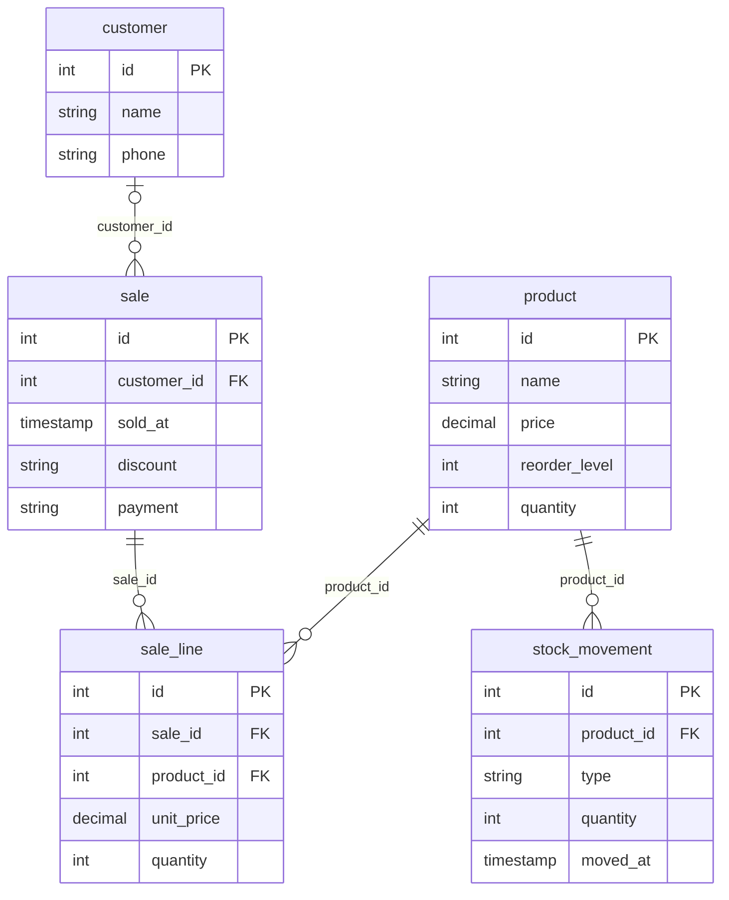

<!-- Generated by scripts/sync-course.mjs from the java-by-building repository. Do not edit. -->

## 1. Learning objectives
After this lesson you can:
- say what a **table**, a **row**, a **column**, a **primary key** and a **foreign key** are;
- explain what goes wrong when everything lives in one flat sheet (repeated facts, facts that disagree);
- tell **one-to-many** from **many-to-many**, and know a many-to-many needs a table in the middle;
- read the shop's **ERD** and turn a sentence such as "a customer can make many sales" into a diagram line;
- open the practice database (H2, in memory, nothing to install) and see the tables the diagram describes.

## 2. Plain-English explanation
Until lesson 24 the shop's data lived in Java objects and CSV files. That works for one shop and one person. It does not work well when two cashiers sell at the same time, when the files grow to 100,000 lines, or when the owner asks "which customers bought Rice in March?". For those jobs the world uses a **database**.

- **Relational database.** A program that keeps data in **tables** and keeps the tables **related** to each other. It checks your rules for you and answers questions written in **SQL** (lesson 26). Examples: PostgreSQL, MySQL, SQL Server, Oracle. This course uses **H2**: a free database written in Java, one `.jar` file, nothing to install.
- **Table, row, column.** A table is a grid about *one kind of thing* (products). Each **row** is one thing (Rice 25kg). Each **column** is one fact about every row (price). Compare: a Java class `Product` is like the table, an object is like a row, a field is like a column.

  | Java | Database |
  |---|---|
  | class `Product` | table `product` |
  | one `Product` object | one row |
  | field `price` | column `price` |
  | `BigDecimal`, `int`, `String`, `LocalDateTime` | `DECIMAL(10,2)`, `INT`, `VARCHAR(60)`, `TIMESTAMP` |

- **Why not one big sheet?** Look at `examples/FlatVsRelational.java`. In a sheet every sale row repeats the customer's name and phone and the product's price. Change a phone number in one row and forget another, and the sheet now says Ana has two phones. That is an **update anomaly**. The cure: store each fact **once** and let rows *point* at each other.
- **Primary key (PK).** A column (here `id`) whose value is different in every row and never empty. It is the row's name tag: "product 1". The database can number rows for you (`GENERATED BY DEFAULT AS IDENTITY`).
- **Foreign key (FK).** A column that holds the PK of a row in *another* table. `sale.customer_id = 1` means "this sale was made by the customer whose `id` is 1". The database **refuses** a foreign key that points at nothing (try it in the example): you cannot sell to customer 77 if there is no customer 77. This rule is called **referential integrity**.
- **Relationships.** Ask two questions about two kinds of things, one in each direction:
  - *One customer can make many sales; one sale belongs to (at most) one customer.* That is **one-to-many**. The FK goes on the **many** side: `sale.customer_id`.
  - *One sale can contain many products; one product can be in many sales.* That is **many-to-many**. A column cannot hold "many" values, so we add a table **in the middle**, one row per pair: `sale_line` (sale 4 + Sardines + 4 pieces). It has two FKs and also carries facts about the pair (quantity, the unit price at that moment).
  - **Optional or required?** A sale may have *no* customer (a walk-in). So `sale.customer_id` may be empty (`NULL`). A sale line must have a sale and a product, so those FKs are required (`NOT NULL`).
- **ERD (Entity-Relationship Diagram).** A picture of the tables ("entities") and the lines between them. We use **crow's foot** symbols: `||` exactly one, `|o` zero or one, `o{` zero or many. Read `customer |o--o{ sale` as: "a sale has zero or one customer; a customer has zero or many sales".

  The diagram below is **not drawn by hand**. `Erd.mermaid(...)` in this lesson asks the real database what tables and foreign keys it has and writes the text; a test checks that this README shows exactly that text, so it can never go out of date. GitHub draws it as a picture.



- **Where do the Java classes go?** `Product` becomes `product`. `Customer` becomes `customer` (the loyalty *points* are **not** stored: they can be worked out from the sales, and a stored copy could disagree with the sales). `Sale` becomes `sale` plus one `sale_line` per `SaleLine` (a record, so far one per sale; the table allows many). `StockMovement` becomes `stock_movement`. The `discount` is kept as the same short text the CSV file used (`none`, `percent:10`, `senior`).
- **Same ideas, any database.** Everything here is true in PostgreSQL and MySQL too. The differences are small and are listed in lesson 28 ("What changes on PostgreSQL or MySQL").
- **What was added to the app:** package `dev.javabybuilding.sql` (the **practice harness**: `SqlRunner` runs SQL text, `QueryResult` prints a table, `PracticeDb` opens a fresh in-memory H2 with the sample shop, `Erd` draws the diagram), `src/main/resources/sql/schema.sql` and `seed.sql`. The app itself still saves to CSV files; it learns the database in lessons 29-32.

## 3. Runnable sample code
The examples talk to H2, so Java needs the H2 jar on its **class path**. Maven downloads it into your `~/.m2` folder the first time you build; this command fetches only the jar (once):
```bash
./mvnw -q dependency:get -Dartifact=com.h2database:h2:2.4.240
```
Then run an example from the repository root (Git Bash / macOS / Linux; in PowerShell write `$env:USERPROFILE\.m2\repository\...` for the jar):
```bash
java -cp ~/.m2/repository/com/h2database/h2/2.4.240/h2-2.4.240.jar lessons/25-relational-thinking/examples/FlatVsRelational.java
java -cp ~/.m2/repository/com/h2database/h2/2.4.240/h2-2.4.240.jar lessons/25-relational-thinking/examples/ReadTheErd.java
```
Or run every example of the course at once: `bash scripts/run-examples.sh` (it finds or downloads the jar for you).
- `FlatVsRelational.java`: the same data as a flat sheet and as related tables. Shows the update anomaly and the database refusing a dangling foreign key.
- `ReadTheErd.java`: builds the shop's tables from `schema.sql`, then asks `DatabaseMetaData` for every primary and foreign key.

A taste of SQL (lesson 26 teaches it). Every `sql` block in these READMEs is run against H2 by a test, and the output under it is compared character by character with what H2 really prints:
```sql
SELECT id, customer_id, sold_at, payment FROM sale ORDER BY id;
```
```text
id | customer_id | sold_at             | payment
---+-------------+---------------------+--------
1  | 1           | 2026-03-01 09:30:00 | CASH
2  | NULL        | 2026-03-01 10:15:00 | GCASH
3  | 2           | 2026-03-02 14:05:00 | CASH
4  | 1           | 2026-03-02 16:40:00 | CARD
5  | NULL        | 2026-03-03 09:10:00 | CASH
(5 rows)
```
Sales 2 and 5 have `NULL` in `customer_id`: the walk-in customers.

## 4. Step-by-step: meet the shop's database
Starter = lesson 24's solution plus the practice harness. One method is still empty: `Erd.relationships`.
1. Read `src/main/resources/sql/schema.sql` next to the ERD above. Find each primary key and each `REFERENCES`.
2. Run both examples (section 3). Read `FlatVsRelational`'s output line by line.
3. Open `SqlRunner`, `QueryResult` and `PracticeDb`. You do not need to change them; notice how `PracticeDb.open()` makes a new database with a random name each time, so tests never disturb each other.
4. Run `../../../mvnw test` in `starter`. Four tests fail (`ErdTest` and `ReadmeSqlTest`): the diagram has no lines because `Erd.relationships` returns an empty list.
5. **TODO 1 — `Erd.relationships`**: for each table ask `getImportedKeys` for the tables it points at; build a `Relationship` for each; sort. Read the hint in the file. Run `ErdTest`, then everything.
6. Open `lessons/25-relational-thinking/solution/src/main/resources/sql/seed.sql` and find sale 4 (Ana, 2 March, CARD, senior). Using the ERD, say which rows in which tables belong to it.
7. Add your own relationship on paper: a **supplier** supplies many products. Which table gets the foreign key? (Exercise 1 and 2 make you write it.)

## 5. Practical exercises
In `exercises/` (`ErdDrills.java`, tests in `Exercises25Test.java`). The tests build a tiny database in memory and run your SQL:
1. `createSupplierTable()` returns the `CREATE TABLE` text for a `supplier` table (self-numbered id as primary key, required name, optional phone).
2. `linkProductToSupplier()` returns the `ALTER TABLE` text that adds an optional `supplier_id` foreign key to `product`.
3. `customersWithConflictingPhones(rows)`: given the rows of a flat sheet, return the customers who appear with more than one phone number. This is the Java version of the problem you saw in the example.

*Stretch (on paper):* a customer can have several phone numbers. Draw the ERD: which new table, which FK, which side is "many"?

## 6. Expected results
`FlatVsRelational.java` prints:
```text
== 1. One flat sheet: every row repeats the customer and the product details
sale_no | customer  | phone         | product       | price   | qty
--------+-----------+---------------+---------------+---------+----
1       | Ana Reyes | 0917 123 4567 | Rice 25kg     | 1250.50 | 2
4       | Ana Reyes | 0917 123 4567 | Rice 25kg     | 1250.50 | 1
4       | Ana Reyes | 0917 123 4567 | Sardines 155g | 24.00   | 4
(3 rows)

== 2. Ana gets a new phone. Somebody fixes only the first row ...
customer  | phone
----------+--------------
Ana Reyes | 0917 123 4567
Ana Reyes | 0999 000 1111
(2 rows)
Two phone numbers for one person. The sheet now disagrees with itself (an update anomaly).

== 3. Related tables: each fact is stored ONCE, rows point at each other by id
Ana changes her phone: ONE row to update.
id | name      | phone
---+-----------+--------------
1  | Ana Reyes | 0999 000 1111
(1 row)

The receipt is put back together by following the ids (a JOIN, lesson 27):
sale | customer  | phone         | product       | qty
-----+-----------+---------------+---------------+----
1    | Ana Reyes | 0999 000 1111 | Rice 25kg     | 2
4    | Ana Reyes | 0999 000 1111 | Rice 25kg     | 1
4    | Ana Reyes | 0999 000 1111 | Sardines 155g | 4
(3 rows)

== 4. The database refuses a row that points at nothing
Refused: no customer 77 exists (SQL state 23506)
```
`ReadTheErd.java` prints:
```text
Tables: 5

customer
  primary key : id

product
  primary key : id

sale
  primary key : id
  foreign key : customer_id -> customer.id

sale_line
  primary key : id
  foreign key : product_id -> product.id
  foreign key : sale_id -> sale.id

stock_movement
  primary key : id
  foreign key : product_id -> product.id
```
Test counts:
- `solution` module: **488 tests, 0 failures** (lesson 24's 450, plus 27 for the harness: 10 `SqlRunnerTest`, 5 `QueryResultTest`, 5 `PracticeDbTest`, 5 `ErdTest`, 2 `ReadmeSqlTest`; and 11 `Exercises25Test`). The only edit to an old test is the version line in `MainTest`.
- `starter` before you start: 286 tests, **4 failures** (all about the diagram). After the TODO: all green.
- `exercises` before you start: 11 tests, **2 failures and 7 errors**. After: all green.

## 7. Common mistakes and troubleshooting
| Symptom | Cause | Fix |
|---|---|---|
| `Could not find or load main class` / `package org.h2 does not exist` when running an example | The H2 jar is not on the class path | Use `java -cp <jar> File.java` (section 3), or `bash scripts/run-examples.sh` |
| The jar is not at `~/.m2/...` | It was never downloaded | `./mvnw -q dependency:get -Dartifact=com.h2database:h2:2.4.240` |
| `Referential integrity constraint violation` | A foreign key points at a row that does not exist (or you deleted a row that others point at) | Insert the parent row first; delete the children first |
| `Table "PRODUCT" not found` | You connected to an empty database (a new in-memory database starts empty and vanishes when closed) | Use `PracticeDb.open()`, which creates the tables and rows |
| `NULL` is not the same as an empty text or 0 | `NULL` means "no value at all" | Test with `IS NULL`, never `= NULL` (lesson 26) |
| Two people with the same name in one table | A name is not a key: names repeat, ids do not | Point at rows by their primary key |
| Storing a number you can work out (points, totals) | The copy can drift from the facts | Store the facts (sales); compute the totals |

## 8. Verifiable completion criteria
- [ ] `starter`: `../../../mvnw test` → all tests green after TODO 1
- [ ] `exercises`: `../../../mvnw test` → all 11 tests green
- [ ] `bash scripts/run-examples.sh` runs both new examples
- [ ] `ReadmeSqlTest` is green: the ERD and the `sql` block in this README are exactly what H2 produces
- [ ] You can explain, without notes, why `sale_line` exists and why `sale.customer_id` may be empty
- [ ] You can draw (on paper) the ERD for "a supplier supplies many products" and say where the foreign key goes
